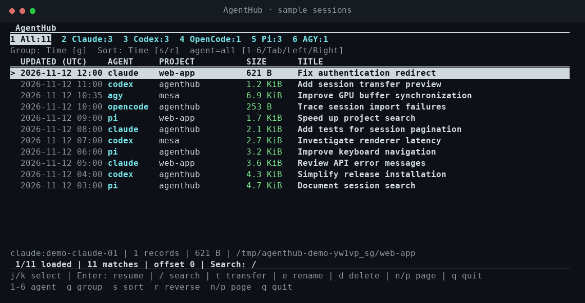

<div align="center">

# AgentHub

**Your coding-agent sessions, in one place.**

Browse conversation history, find past work, and pick up where you left off across Claude Code, Codex, OpenCode, Pi, and Google Antigravity CLI (AGY).

[Installation](#installation) · [Getting started](#getting-started) · [Usage](#usage) · [中文](README.zh-CN.md)

[](https://github.com/shareu007/agenthub/actions/workflows/ci.yml)
[](LICENSE)

</div>



*Recorded from AgentHub with sample sessions. No private conversations are shown.*
[View a still image](docs/assets/demo.png).

## Installation

macOS 13+ / Linux · ARM64 / x86_64 · Installs both `ah` and `agenthub`.

### Install script (published releases)

```sh
curl -fsSL https://raw.githubusercontent.com/shareu007/agenthub/main/install.sh -o install.sh
sh install.sh
```

### Offline binary package

Download your platform archive and its `.sha256` file from
[Releases](https://github.com/shareu007/agenthub/releases), and copy both to the offline machine.
Extract the archive, then use its included installer:

```sh
sh install.sh --archive ./agenthub-x86_64-unknown-linux-musl.tar.gz
```

[Platform packages and offline steps](docs/install.md#offline-installation).
Prebuilt downloads require a published Release; source installation is available now.

### Build from source

Requires [Rust 1.85+](https://rustup.rs/), Git and a C compiler.

```sh
git clone https://github.com/shareu007/agenthub.git
cd agenthub
cargo install --locked --path crates/cli --force
```

[Version, directory and PATH options](docs/install.md).


## Why AgentHub?

A useful conversation shouldn't get lost because you switched tools or projects.
AgentHub brings your local session history into a searchable list, then opens a
session in the agent that created it.

- **Find past work.** Search conversations, filter by agent or project, and sort by time or size.
- **Resume in a keystroke.** Select a session and press Enter to open its original agent.
- **Move a conversation.** Transfer user and assistant text into a new session in another agent.
- **Keep things organized.** Give sessions a recognizable display name, or permanently delete sessions you no longer need.
- **Keep it local.** No AgentHub account or background service. Browsing and indexing don't send your conversations anywhere.

## Getting started

Install AgentHub using one of the methods above, then run:

```sh
ah sync
ah
```

Both `ah` and `agenthub` open the same tool. Sessions appear in one list, newest
first. Press Enter to resume a session, `/` to search, and `q` to quit.

Install the agents you use and make their commands available in your terminal.
`ah sync` discovers sessions for those agents. If something is missing, run
`ah doctor` to check their locations.

## Usage

### Browse and search

```sh
ah                                  # Open the session browser
ah sync                             # Refresh session history
ah list --agent codex                # Browse one agent
ah list --group-by project           # Organize by project
ah list --sort size                  # Largest conversations first
ah search "rendering"                # Search conversation text
ah show codex:SESSION_ID             # Read a conversation
```

| Key | Action |
| --- | --- |
| ↑ / ↓ or `j` / `k` | Select a session |
| Enter | Resume in the original agent |
| `/` | Search conversations, titles, projects, and IDs |
| `1`–`6` | All, Claude, Codex, OpenCode, Pi, AGY |
| Tab / ← / → | Switch agent |
| `g` / `s` / `r` | Change grouping / sort / direction |
| `e` | Rename the session's display title |
| `t` | Transfer to another agent, with a preview |
| `d` | Permanently delete, after confirmation |
| `n` / `p` | Next / previous page |
| Esc / `q` | Cancel / quit |

Run `ah help` for commands, or `ah help list` for filters and sorting options.

### Resume or transfer

```sh
ah resume codex:SESSION_ID --exec
ah transfer codex:SESSION_ID --to pi --dry-run
ah transfer codex:SESSION_ID --to pi
```

Transfer creates a new native session and adds it to the list. The original stays
in place. It copies conversation text; tool state, permissions, reasoning, and
attachments don't carry over. AGY is currently a transfer source, not a destination.

Resuming starts the original agent, which uses its own settings and account.
If you moved a project, pass its new location:

```sh
ah resume codex:SESSION_ID --cwd /new/project --exec
```

### Rename or delete

```sh
ah rename pi:SESSION_ID "Investigate renderer latency"
ah rename pi:SESSION_ID --reset
ah delete pi:SESSION_ID              # Preview only
ah delete pi:SESSION_ID --yes        # Permanently delete
```

Renames are display names in AgentHub and survive syncing. Deletion removes the
native session and its AgentHub history; it cannot be undone. Stop the session in
its agent before deleting it. Native deletion currently supports Claude, Codex,
Pi, and the verified OpenCode v1 database format. For AGY, use its `/resume` picker.

## Supported agents

| Agent | Browse & search | Resume | Transfer into |
| --- | --- | --- | --- |
| Claude Code | Yes | Implemented; verification pending | Text only; verification pending |
| Codex CLI | Yes | Verified for transferred sessions | Text only |
| OpenCode | Yes | Verified | Text only, via the native importer |
| Pi Coding Agent | Yes | Verified | Text only |
| Google Antigravity CLI (AGY) | Yes | Verified | Not yet |

Agent formats change. See [tested versions and verification status](docs/compatibility.md)
for details. This is an early release; platform support doesn't guarantee
compatibility with every agent version.

## Configuration and local data

Defaults work for standard agent installations. To use custom session locations,
copy [agenthub.example.toml](agenthub.example.toml) to
`~/.config/agenthub/config.toml`, or pass `--config /path/to/config.toml`.
The corresponding XDG environment variables are respected.

The local index is stored at `~/.local/share/agenthub/index.db` by default. It
contains conversation data: treat it like your original session history.
Discovery and syncing only read the original files. Transfer and confirmed
native deletion are explicit actions that write to agent stores.

For archived/offline stores whose agent is no longer installed:

```sh
ah sync --include-unavailable
```

Use `--json` for scripts, or `list --no-interactive` for plain output.
See [CLI options](docs/cli-design.md) and [transfer details](docs/session-transfer.md).

## Contributing

Bug reports and small, focused improvements are welcome. When reporting a format
problem, include your OS, agent version, and the command that failed. Don't post
private conversations, credentials, or your session database.

```sh
cargo test --locked --workspace
cargo clippy --locked --workspace --all-targets -- -D warnings
```

See [architecture](docs/architecture.md) for the code layout and
[releasing](docs/releasing.md) for packaging, platform checks, and demo recording.

## License

[MIT](LICENSE). See [third-party notices](THIRD_PARTY_NOTICES.md) for acknowledgements.
