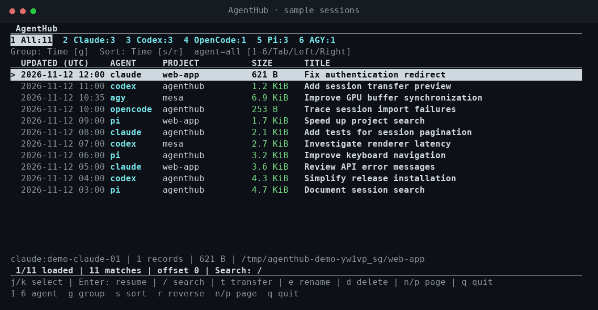

<div align="center">

# AgentHub

**把不同 Coding Agent 的会话，放在一起管理。**

查看历史对话、找到之前的工作，再回到原来的 Agent 继续开发。支持 Claude Code、Codex、OpenCode、Pi 和 Google Antigravity CLI（AGY）。

[安装](#安装) · [快速开始](#快速开始) · [使用](#使用) · [English](README.md)

</div>



*演示由真实 CLI 录制，使用示例会话，不包含私人对话。*
[查看静态截图](docs/assets/demo.png)。

## 安装

macOS 13+ / Linux · ARM64 / x86_64 · 同时安装 `ah` 和 `agenthub`。

### 安装脚本（发布后可用）

```sh
curl -fsSL https://raw.githubusercontent.com/shareu007/agenthub/main/install.sh -o install.sh
sh install.sh
```

### 离线二进制包

从 [Releases](https://github.com/shareu007/agenthub/releases) 下载对应平台的压缩包和 `.sha256` 文件，
一起复制到离线机器。解压后使用包内的安装脚本：

```sh
sh install.sh --archive ./agenthub-x86_64-unknown-linux-musl.tar.gz
```

[各平台安装包与离线步骤](docs/install.md#offline-installation)。
预构建下载需要先发布 Release；目前也可直接从源码安装。

### 从源码安装

需要 [Rust 1.85+](https://rustup.rs/)、Git 和 C 编译器。

```sh
git clone https://github.com/shareu007/agenthub.git
cd agenthub
cargo install --locked --path crates/cli --force
```

[指定版本、安装目录和 PATH 配置](docs/install.md)。


## 功能

- **找回之前的工作。** 搜索对话，按 Agent、项目筛选，按时间或大小排序。
- **回车继续开发。** 选中会话，直接用原来的 Agent 打开。
- **在 Agent 之间移交对话。** 把用户和助手的文字复制到另一个 Agent 的新会话中。
- **整理会话。** 修改显示标题，或确认后永久删除不需要的会话。
- **本地使用。** 无需 AgentHub 账号或后台服务；浏览、索引不会上传你的对话。

## 快速开始

安装后运行：

```sh
ah sync
ah
```

`ah` 和 `agenthub` 是同一个工具。默认列出所有会话，最新的在前面。
回车恢复会话，`/` 搜索，`q` 退出。

请先安装要使用的 Agent，并确保其命令在终端中可用。默认同步这些 Agent 的历史；
会话没有出现时，可以用 `ah doctor` 检查存储位置和客户端。

## 使用

```sh
ah                                  # 打开会话列表
ah sync                             # 更新历史
ah list --agent codex                # 只看 Codex
ah list --group-by project           # 按项目分类
ah list --sort size                  # 大会话在前
ah search "rendering"                # 搜索对话
ah show codex:SESSION_ID             # 阅读完整会话
```

| 按键 | 操作 |
| --- | --- |
| ↑ / ↓ 或 `j` / `k` | 选择会话 |
| Enter | 用原 Agent 恢复会话 |
| `/` | 搜索对话、标题、项目和 ID |
| `1`–`6` | All、Claude、Codex、OpenCode、Pi、AGY |
| Tab / ← / → | 切换 Agent |
| `g` / `s` / `r` | 切换分类 / 排序 / 方向 |
| `e` | 修改显示标题 |
| `t` | 预览并移交到另一 Agent |
| `d` | 确认后永久删除 |
| `n` / `p` | 下一页 / 上一页 |
| Esc / `q` | 取消 / 退出 |

`ah help` 查看命令，`ah help list` 查看筛选和排序选项。

### 恢复与移交

```sh
ah resume codex:SESSION_ID --exec
ah transfer codex:SESSION_ID --to pi --dry-run
ah transfer codex:SESSION_ID --to pi
```

移交创建新的原生会话，并自动加入列表，原会话保持不变。
目前复制用户和助手文字，不迁移工具状态、权限、思考内容或附件。
AGY 当前可作为来源，尚不能作为移交目标。

恢复会启动原 Agent，使用它自己的账号和配置。项目移动后可指定新目录：

```sh
ah resume codex:SESSION_ID --cwd /new/project --exec
```

### 重命名与删除

```sh
ah rename pi:SESSION_ID "排查渲染延迟"
ah rename pi:SESSION_ID --reset
ah delete pi:SESSION_ID              # 只预览
ah delete pi:SESSION_ID --yes        # 永久删除
```

显示名保存在 AgentHub 中，同步后仍然保留。删除会移除原生会话及其 AgentHub 历史，无法撤销；
请先在原 Agent 中停止该会话。目前支持 Claude、Codex、Pi 和已验证的 OpenCode v1 数据库。
AGY 请通过其 `/resume` 界面删除。

## Agent 支持情况

| Agent | 浏览与搜索 | 恢复 | 移交到该 Agent |
| --- | --- | --- | --- |
| Claude Code | 支持 | 已实现，原生加载仍待验证 | 仅文字，原生加载仍待验证 |
| Codex CLI | 支持 | 已验证移交会话的加载 | 仅文字 |
| OpenCode | 支持 | 已验证 | 仅文字，使用原生导入 |
| Pi Coding Agent | 支持 | 已验证 | 仅文字 |
| Google Antigravity CLI（AGY） | 支持 | 已验证 | 暂不支持 |

Agent 的存储格式会变化，详见[已测试版本和验证状态](docs/compatibility.md)。
项目仍处于早期阶段，平台支持不代表兼容每一个 Agent 版本。

## 配置与本地数据

标准安装通常无需配置。需要自定义会话位置时，将
[agenthub.example.toml](agenthub.example.toml) 复制到 `~/.config/agenthub/config.toml`，
或通过 `--config /path/to/config.toml` 指定。对应的 XDG 环境变量也会生效。

索引默认位于 `~/.local/share/agenthub/index.db`，里面包含对话数据，请像原生历史一样保管。
发现和同步仅读取原文件；移交和经过确认的原生删除会写入 Agent 存储。

原 Agent 已卸载、但想读取旧历史时：

```sh
ah sync --include-unavailable
```

脚本调用可用 `--json`，纯文本列表可用 `list --no-interactive`。
更多用法见 [CLI 说明](docs/cli-design.md)和[会话移交](docs/session-transfer.md)。

## 参与贡献

欢迎提交问题和小范围改进。报告格式问题时，请提供系统、Agent 版本和失败命令；
不要上传私人对话、凭据或会话数据库。

```sh
cargo test --locked --workspace
cargo clippy --locked --workspace --all-targets -- -D warnings
```

开发说明见[架构](docs/architecture.md)，打包、平台验证及演示录制见[发布说明](docs/releasing.md)。

## 许可证

[MIT](LICENSE)。致谢与第三方许可见 [THIRD_PARTY_NOTICES.md](THIRD_PARTY_NOTICES.md)。
